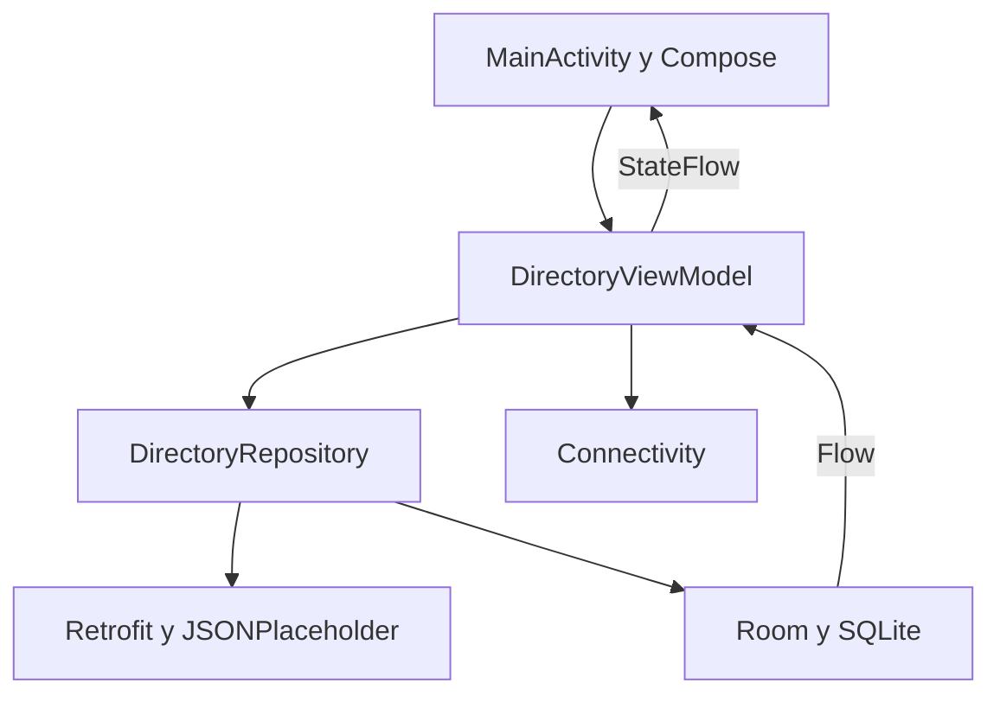

# Directorio de usuarios · JSONPlaceholder

Jeffrey Fernandez · Matrícula 1-21-1476 · UTESA

App Android nativa en Kotlin, Jetpack Compose, Retrofit y Room, con MVVM.
Este es un proyecto independiente de Mi Recetario. Se abre en **Android Studio**, no en Visual Studio. La versión Android no se instala en un iPhone.

## Ejecutar

1. Extrae el ZIP completo.
2. En Android Studio, selecciona **Open** y abre la carpeta `DirectorioUsuarios` que contiene `settings.gradle.kts`.
3. Permite la sincronización Gradle. Usa JDK 17 y Android SDK 35. Si falta el SDK, acepta instalarlo desde Android Studio.
4. En Device Manager crea un emulador Android API 26 o superior, o conecta un Android con depuración USB.
5. Pulsa Run. La primera carga requiere Internet.

Las versiones están fijadas para reproducibilidad: AGP 8.7.3, Gradle 8.9, Kotlin 1.9.25, Room 2.6.1 y Retrofit 2.11.0. No se necesitan claves ni servidor propio.

## Funciones

- `GET /users`: nombre, correo y `company.name`.
- Toca una tarjeta para consultar todos los datos del usuario y `GET /posts?userId={id}`.
- La estrella añade o quita favoritos, con controles accesibles de 48 dp.
- La pestaña Favoritos funciona sin conexión y persiste al cerrar o reiniciar la app.
- Los usuarios se guardan en Room. Las publicaciones se guardan al consultarlas: si nunca se descargaron, se informa claramente sin inventar contenido.
- Carga visible, errores con reintento y aviso cuando no hay Internet. Los fallos de red y almacenamiento se capturan en el ViewModel.
- Se conserva la pantalla seleccionada con SavedStateHandle y el estado en rotaciones con ViewModel.
- Al volver la conexión se intenta actualizar. También existe actualización manual.

## Arquitectura



La UI envía acciones; el ViewModel maneja el estado y las corrutinas; el repositorio coordina API y persistencia. Room almacena usuarios, IDs favoritos y caché de publicaciones por usuario. Guardar solo IDs no bastaría para mostrar un favorito sin conexión; por eso también se conservan sus datos completos. No se borran favoritos al actualizar los usuarios.

## Pruebas

Windows:

```powershell
.\gradlew.bat testDebugUnitTest assembleDebug
.\gradlew.bat connectedDebugAndroidTest
```

Linux/macOS:

```bash
./gradlew testDebugUnitTest assembleDebug
./gradlew connectedDebugAndroidTest
```

`ApiTest` usa MockWebServer y verifica GET, el mapeo de company, el filtro userId y HTTP 500.
`PersistenceTest` escribe en Room, cierra y vuelve a abrir la base, verifica que los favoritos y las publicaciones siguen guardados y que actualizar usuarios no borra favoritos.
`ScreenEvidenceTest` renderiza **las pantallas reales Compose** con estados controlados. Genera capturas de carga, éxito, detalle, favoritos, sin conexión y HTTP 500. No son evidencia de llamadas de red en vivo. Los ejemplos corresponden a JSONPlaceholder; el cuerpo de la publicación usado en la prueba es un extracto.

`RenderEvidenceTest` genera también capturas en la PC mediante Robolectric, sin emulador, ejecutando `testDebugUnitTest`. Guarda los PNG en `app/build/evidence`. `LocalPersistenceTest` ejecuta la comprobación de Room en ese mismo entorno. Los resultados de esta entrega figuran en `docs/verificacion/RESULTADOS.md`.

Las capturas de la prueba instrumentada se guardan en:
`/sdcard/Android/data/edu.utesa.directorio/files/evidencias/`

Para extraerlas, con Android SDK Platform Tools en PATH:

```bash
adb pull /sdcard/Android/data/edu.utesa.directorio/files/evidencias docs/capturas
```

## Comprobación manual antes de entregar

1. Ejecutar con Internet y comprobar los 10 usuarios.
2. Abrir a Leanne Graham y comprobar que aparecen sus publicaciones.
3. Guardar dos favoritos, cerrar y volver a abrir la app.
4. Desactivar Wi-Fi y datos móviles: abrir Favoritos y detalle; comprobar que aparecen los datos locales.
5. Abrir sin conexión un usuario cuyas publicaciones no se consultaron: comprobar el aviso correspondiente.
6. Rotar durante la carga y en el detalle; no deben perderse favoritos ni duplicarse solicitudes por la rotación.
7. Restaurar la conexión y comprobar la actualización.

## Publicar el repositorio

El repositorio remoto no se crea automáticamente. Nombre sugerido: `directorio-jsonplaceholder`.

1. Inicia sesión en GitHub y crea un repositorio con ese nombre.
2. Sube el contenido de esta carpeta. No subas `local.properties`, `.gradle`, `.idea` ni carpetas `build`.
3. Con Git instalado, desde la carpeta:

```bash
git init
git add .
git commit -m "Directorio Android con Retrofit y favoritos offline"
git branch -M main
git remote add origin URL_REAL_DEL_REPOSITORIO
git push -u origin main
```

`URL_REAL_DEL_REPOSITORIO` se sustituye por la URL que GitHub muestra al crearlo. Copia el enlace real y añádelo al PDF. No se proporciona un enlace ficticio como si estuviera publicado.

## Alcance

- JSONPlaceholder usa datos ficticios y no exige login.
- Los favoritos son locales a este dispositivo; no se sincronizan entre equipos.
- Se conserva una caché del directorio para el trabajo offline; los datos retirados del servidor pueden seguir en caché. Es adecuado para esta API de demostración estática; una API dinámica requeriría política de borrado/caducidad.
- No se usa `allowMainThreadQueries`: Room y Retrofit trabajan sin bloquear la UI.
- La base es local y privada; no se almacenan tokens ni contraseñas.
- El respaldo automático se desactiva para mantener el alcance local de los favoritos.

## Fuentes

- https://jsonplaceholder.typicode.com/
- https://github.com/square/retrofit
- https://developer.android.com/topic/libraries/architecture/viewmodel
- https://developer.android.com/training/data-storage/room
- https://developer.android.com/develop/connectivity/network-ops/connecting

## APK incluido

`apk/DirectorioUsuarios-debug.apk` es la compilación de demostración para Android. No se puede instalar en iPhone. El PDF incluye capturas de pruebas con estados controlados; la API real se verificó por separado.
